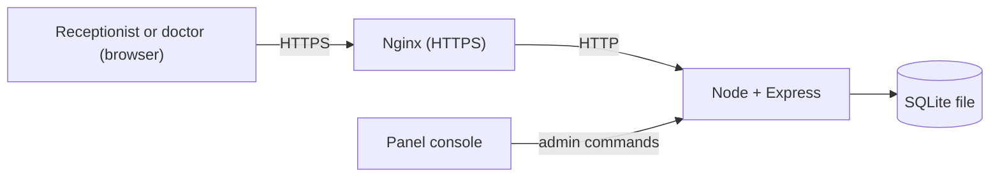

# Patient Onboarding (without Firebase)

A small patient management app for a clinic. A receptionist registers patients, and a doctor reviews, edits and deletes them. Both see the same list, and it updates live without a reload.

**Live site:** https://po.kevinsidd.dev

All the data in it is fake. This is an onboarding assignment, not a system for real patients.

## Where it came from

This project started from [`for-mickey`](../for-mickey/README.md), the same app built on Firebase, where the browser talks directly to Google's services and there's no server of my own.

The assignment was to rebuild it without Firebase, with these rules:

- The screens and workflow stay the same.
- No Firebase packages, config or services.
- The server has to enforce permissions and validation, at least as strictly as the Firebase rules did.
- It runs publicly over HTTPS on my own domain.
- It stays simple enough to explain line by line.

So the frontend was carried over, and everything Firebase did had to be replaced:

| Firebase did this | Now it's done by | Where |
| --- | --- | --- |
| Authentication | Password hashing and login sessions | `controllers/auth.js`, `services/passwords.js`, `services/sessions.js` |
| Firestore | SQLite database, one file on the server | `config/db.js`, `services/patients.js` |
| Security Rules | Login and role checks, field validation | `middlewares/auth.js`, `validators/patient.js` |
| `onSnapshot` live updates | Server-Sent Events | `services/events.js`, plus `EventSource` in the frontend |
| Remote Config | A row in the `config` table | `services/config.js` |
| Firebase console | Commands typed into the server's console | `commands.js` |
| Hosting | Express serves the build, Nginx handles HTTPS | `app.js`, `deploy/nginx.conf.example` |

## How it was built

Claude Code was used to make the process faster. The design of the project, the modules to use and the way they're used were directed by Kevin Siddhpura.

**1. Backend foundation.** An Express app and a SQLite database with the tables the app needs.

**2. Login and roles.** Email and password login, sessions in a cookie, and checks for who is allowed to do what.

**3. Patients and the delete flag.** The routes to list, create, edit and delete patients, and the route that reads the flag.

**4. Live updates.** When someone changes a patient, the server tells the other open tabs to fetch the list again.

**5. Server and console commands.** The panel has a console that sends text to the running app, so adding users, switching the flag and taking backups became commands typed there.

**6. Frontend.** The React app was copied from `for-mickey`. The screens stayed, and the files in `frontend/src/services/` were rewritten to call the new API with `fetch`, keeping the same function names. Only a few things visibly changed: the header text, a "Server unavailable" screen and a message when logout fails.

**7. Tidying the structure.** The backend moved to the usual Express layout of routes, controllers and services, so each file has one job.

**8. Keeping it minimal.** Extra protections from the first version were removed, because the data is fake and the code should stay easy to explain. These were a login attempt limit, hashed session tokens, a secret header between Nginx and the app, and a few smaller checks.

**9. Going live.** The app was deployed to a server on my Pterodactyl panel, with Nginx and a Let's Encrypt certificate in front of it. See [Hosting](#hosting).

### Why these choices

| Choice | Why |
| --- | --- |
| Node 24 and Express | Small and well known, and the frontend is already JavaScript |
| SQLite (`better-sqlite3`) | No separate database server to run. MongoDB was considered and dropped for this reason |
| No ORM, auth library or cookie library | Less to explain, and the SQL and login code are easy to read directly |
| `scrypt` for passwords | Built into Node, so it needs no extra package |
| Server-Sent Events | Updates only go from the server to the browser, so WebSockets aren't needed |
| A `.env` file and console commands | The app runs in a panel container, where these are the simple ways to set it up and manage it |

## What the app does

1. A user signs in with an email and password. There's no sign-up screen, because accounts are added from the console.
2. The receptionist sees a registration form and the patient list.
3. The doctor sees the same list without the form, and can edit a patient's name, phone and condition.
4. The doctor can delete a patient only when the delete flag is on. It's switched from the console, and "Refresh config" shows or hides the button without a redeploy. If a page still shows the button after the flag goes off, the server refuses the delete and the page hides the button.
5. Logging out returns to the login page.

The list shows the 50 most recent patients.

| Action | Receptionist | Doctor | Signed out / no valid role |
| --- | --- | --- | --- |
| Create patient | Allowed | Denied | Denied |
| Read patient list | Allowed | Allowed | Denied |
| Edit patient | Denied | Allowed | Denied |
| Delete patient | Denied | Allowed while the delete flag is on | Denied |

The server checks these on every request, so hiding a button is only a convenience. Each delete also reads the flag from the database, so a doctor can't delete through an old page or the API when it's off.

## How it works

One Node server does everything: it serves the React build, the JSON API and the live updates.



### What happens when a patient is added

1. The browser sends `POST /api/patients` with the name, phone and condition.
2. `routes/patients.js` runs the checks for this URL. `requireSession` confirms the user is logged in, and `requireRole` confirms they're a receptionist.
3. `controllers/patients.js` validates the fields with `validators/patient.js`.
4. `services/patients.js` adds the ID and timestamps and saves the row to SQLite.
5. The controller tells `services/events.js` that something changed, and it sends a "changed" signal to the other open tabs.
6. Those tabs fetch the list again. The signal itself carries no patient data, so every read still goes through the role checks.

### Project layout

```
own/
├── backend/
│   ├── src/
│   │   ├── server.js      starts everything and reads console commands
│   │   ├── app.js         puts the Express app together
│   │   ├── commands.js    the console commands
│   │   ├── config/        opens the database and creates the tables
│   │   ├── routes/        URLs, and which middleware and controller they use
│   │   ├── middlewares/   login and role checks, error handling
│   │   ├── controllers/   read the request and send the response
│   │   ├── services/      the logic and the SQL
│   │   ├── validators/    patient field checks
│   │   └── utils/         ApiError
│   ├── scripts/           seed local accounts, make a user line
│   └── tests/
├── frontend/
│   ├── src/
│   │   ├── components/    the screens
│   │   ├── hooks/         connect the services to React state
│   │   └── services/      all the calls to the backend
│   └── tests/
└── deploy/                example Nginx config
```

### Data

| Table | Holds |
| --- | --- |
| `users` | Email, password hash, name and role (`receptionist` or `doctor`) |
| `patients` | Name, phone, condition and timestamps |
| `sessions` | Each login token and when it expires, after 7 days |
| `config` | The delete flag |

Patient text must be trimmed and non-empty, with limits of 100, 20 and 500 characters. The server sets the ID and timestamps, and rejects any other fields.

## Compared to for-mickey

Both apps do the same job for the user. The difference is who runs the backend.

| | `for-mickey` (Firebase) | This version |
| --- | --- | --- |
| **Backend code** | None of my own, only `firestore.rules` | Node and Express, about 630 lines |
| **Hosting** | Firebase Hosting | Pterodactyl panel, Nginx and my own domain |
| **HTTPS** | Comes with Hosting | Nginx and a Let's Encrypt certificate |
| **Database** | Cloud Firestore, run by Google | One SQLite file on the server |
| **Login** | Firebase Authentication | `scrypt` password hashes and a 7-day `HttpOnly` cookie |
| **Login limit** | Handled by Firebase | None |
| **Permissions** | Security Rules | Express middleware and validation |
| **Live updates** | `onSnapshot` delivers the new data | A signal tells the tab to fetch the list again |
| **Delete flag** | Remote Config for the button, cached for up to 12 hours by default in production, plus a Firestore switch the rules check on each delete | One database row, read on each "Refresh config" and each delete |
| **Adding a user** | Create the account in the console, then a `/users/<UID>` document by hand | Paste one `user add` line into the panel console |
| **Backups** | No backup step set up | `backup` console command |
| **Running locally** | Node, plus Java for the emulators | Only Node |
| **Testing access rules** | Rules tests against the Firestore emulator | API tests against a temporary database |
| **Deploying** | `npx firebase deploy` | Upload to the panel, plus Nginx and a firewall rule set up once |
| **Scaling** | Firebase handles it | One server process, because live updates are kept in memory |

- **`for-mickey`** is far less work to run, because Google looks after the servers, database, login and certificates. The cost is that the app depends on Firebase's services and limits, and much of what happens is out of sight.
- **This version** isn't tied to a vendor, and all the data sits in one file. Everything from password hashing to the live list is code that can be read and changed. The cost is that security, backups, updates and uptime become my job.

## Running it locally

You need Node.js 24. Start the backend from `own`:

```bash
cd backend
npm install
npm run seed     # creates two local accounts and prints the password
npm run dev
```

Then start the frontend from `own`, in a second terminal:

```bash
cd frontend
npm install
npm run dev
```

Open http://localhost:5173 and sign in as `receptionist@example.test` or `doctor@example.test`. To see live updates, use a second browser or an incognito window for the other account.

To try the delete flag, type `flag on` in the backend's terminal and press "Refresh config" in the app.

## Testing

Run these in both `backend` and `frontend`:

| Command | What it does |
| --- | --- |
| `npm test` | Unit and API tests. The backend tests use a temporary database |
| `npm run lint` | ESLint |

## Console commands

Type these in the panel console, or in the terminal running the backend.

| Command | What it does |
| --- | --- |
| `flag`, `flag on`, `flag off` | Show the delete flag, or allow or block deleting patients |
| `user add <email> <role> <hash> <name>` | Add a user |
| `user remove <email>` | Remove a user and their sessions |
| `user list` | List users |
| `backup` | Write a copy of the database to `data/backups` |
| `help` | List the commands |

Passwords shouldn't go through the console, because it keeps logs. To add a user, run `npm run user:hash` in `backend` on your own machine. It asks for the details and prints a `user add ...` line with only the password's hash in it, which you paste into the console.

## Hosting

- **App:** a Node 24 server on my Pterodactyl panel, running from the uploaded `src`, `package.json`, `package-lock.json` and the frontend build in `public`.
- **Settings:** a `.env` file next to the code sets `NODE_ENV`, `DATA_DIR` and `STATIC_DIR`.
- **HTTPS:** Nginx on the same machine, with a Let's Encrypt certificate. The config is based on `deploy/nginx.conf.example`.
- **Firewall:** the app's port is on a public IP, so a rule in Docker's `DOCKER-USER` chain blocks outside traffic to it. Only Nginx can reach the app.
- **Backups:** use the `backup` command and download the file, because copying the `.db` file while the app is running can miss recent writes.

## Known limits

- **Security is basic on purpose.** It has hashed passwords, `HttpOnly` cookies, server-side role checks, field validation and HTTPS. It has no login attempt limit, session tokens are stored unhashed, and blocking direct access relies on the firewall rule. I'd change these before using it with real patients.
- **One process only.** Live updates are kept in memory, so only one copy of the app can run at a time.
