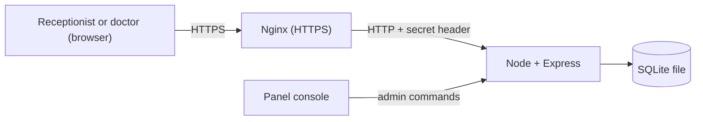

# Patient Onboarding (without Firebase)

The same clinic app as `for-mickey`, but with my own backend instead of Firebase. A receptionist registers patients and a doctor reviews, edits and deletes them. The screens are almost the same; mainly what's behind them changed.

## How it works

One Node server does everything: it serves the React build, the JSON API and the live updates.

- **Express** handles the API.
- **SQLite** (`better-sqlite3`) stores the data in one file.
- **Login** uses email and password. Passwords are hashed with Node's `scrypt`, and the session is kept in an `HttpOnly` cookie.
- **Role checks** run on the server for every request, so hiding a button in the UI is only a convenience.
- **Live updates** use Server-Sent Events. After a write the server sends a "changed" signal to the other tabs and they fetch the list again. The tab that made the change fetches it directly.
- **The delete flag** (`show_delete_button`) is a row in the database, changed from the panel console.



### What replaced what

| Firebase | Here |
| --- | --- |
| Authentication | `routes/auth.js`, `passwords.js`, `sessions.js` |
| Firestore | SQLite, `db.js` |
| Security Rules | `middleware.js`, `validation.js` |
| `onSnapshot` | `events.js`, plus `EventSource` in the frontend |
| Remote Config | `config` table, `routes/config.js` |
| Firebase console | Commands typed into the server's console |
| Hosting | Express serves the build, Nginx handles HTTPS |

### Data

`users` has `uid`, `email`, `password_hash`, `name` and `role` (`receptionist` or `doctor`). A user with no role gets the "profile missing" screen, and any other role value gets no access.

`patients` has `patient_id`, `name`, `phone`, `condition`, `created_at` and `updated_at`. Text must be trimmed and non-empty, with limits of 100, 20 and 500 characters. The server sets the ID and timestamps, and rejects any other fields.

`sessions` stores a SHA-256 hash of each login token, so a copy of the database can't be used to log in. Sessions last 7 days.

`config` holds the delete flag.

### Roles

| Action | Receptionist | Doctor | Signed out / no valid role |
| --- | --- | --- | --- |
| Create patient | Allowed | Denied | Denied |
| Read patient list | Allowed | Allowed | Denied |
| Edit patient | Denied | Allowed | Denied |
| Delete patient | Denied | Allowed | Denied |

The delete flag only hides the button, same as the Firebase version. A doctor can still delete through the API when it's off.

### Code layout

- `backend/src/server.js` starts everything and reads console commands.
- `backend/src/app.js` puts the Express app together, and `backend/src/routes/` has the routes.
- `backend/src/commands.js` has the console commands.
- `frontend/src/services/` is where most of the frontend change is. It keeps the same function names, now using `fetch`. The screens are the same apart from the header text, a "Server unavailable" screen when the session can't be checked, and a message when logout fails.

## Running it locally

You need Node.js 24.

```bash
cd backend
npm install
npm run seed     # creates two local accounts and prints the password
npm run dev

cd frontend      # in a second terminal
npm install
npm run dev
```

Open the address Vite prints and sign in as `receptionist@example.test` or `doctor@example.test`.

To try the delete flag, type `flag on` in the backend's terminal and press "Refresh config" in the app.

## Testing

Run these in both `backend` and `frontend`:

| Command | What it does |
| --- | --- |
| `npm test` | Unit and API tests. The backend tests use a temporary database |
| `npm run lint` | ESLint |

## Console commands

Type these in the panel console, or in the terminal running the backend.

| Command | What it does |
| --- | --- |
| `flag`, `flag on`, `flag off` | Show or set the delete button flag |
| `user add <email> <role> <hash> <name>` | Add a user |
| `user remove <email>` | Remove a user and their sessions |
| `user list` | List users |
| `backup` | Write a copy of the database to `data/backups` |
| `help` | List the commands |

### Adding a user

Passwords shouldn't go through the console because it keeps logs. So on my own machine I run:

```bash
cd backend
npm run user:hash
```

It asks for the details and prints a `user add ...` line with only the password's hash in it. I paste that line into the panel console.

## Deploying

The backend runs on my Pterodactyl panel, with Nginx on the same machine handling HTTPS.

1. Build the frontend on my machine: `cd frontend && npm run build`.
2. Create a server with a Node.js 24 egg, with `src/server.js` as the startup file.
3. Upload `backend/src`, `backend/package.json` and `backend/package-lock.json` to `/home/container`, and the contents of `frontend/dist` to `/home/container/public`. Don't upload `node_modules`, because it's built for the machine it was installed on. There's no shell on the panel, so the install has to come from the egg. The generic Node egg runs `npm install` on startup when it finds a `package.json`, so I check that mine does. If the server stops with a "Cannot find package" error, it doesn't, and the panel admin has to change the egg.
4. Generate a secret: `node -e "console.log(require('crypto').randomBytes(32).toString('hex'))"`.
5. Upload a file called `.env` to `/home/container` with these settings. Eggs usually only show their own variables on the Startup tab, so the file is the reliable way. It sits outside `public`, so it's never served.

   ```
   NODE_ENV=production
   DATA_DIR=/home/container/data
   STATIC_DIR=/home/container/public
   PROXY_SECRET=<the secret>
   ```

6. Start the server and read the console. A line saying `NODE_ENV is not production` means the `.env` file wasn't read, so stop and fix that first. Then type `help`. If the list prints, console input is reaching the app.
7. Set up Nginx from `deploy/nginx.conf.example`, following the certificate steps at the top of that file. This needs access to the machine itself. I don't have SSH right now, so the panel admin has to do it and needs the domain, the allocation's IP and port, and the secret.
8. Add the users, then check the site on the domain. Opening `http://<ip>:<port>` directly should give a 403.

Things to know about production:

- **Direct access.** The app rejects anything that didn't come through Nginx, using the secret header. Someone who types a password at the raw `http://<ip>:<port>` address would still send it unencrypted before seeing the error. If the panel can assign the port on `127.0.0.1`, that closes it completely.
- **Backups.** Use the `backup` command and download the file from the panel's file manager, or stop the server before taking a panel backup. Copying the `.db` file while the app is running can miss recent writes.
- **One process.** Live updates are kept in memory, so this only works with a single server process.
- **Login limit.** 10 failed attempts per email and IP in 15 minutes, and 100 attempts of any kind per IP. It's kept in memory, so a restart resets it.
