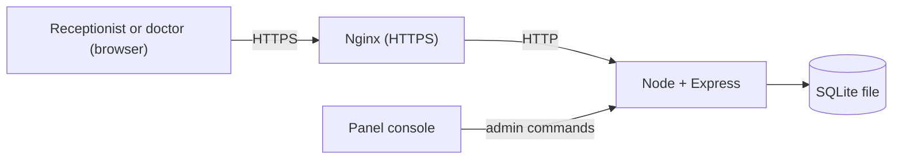

# Patient Onboarding (without Firebase)

A small patient management app for a clinic. A receptionist registers patients, and a doctor reviews, edits and deletes them. Both see the same patient list, and it updates live without a reload.

It's a rebuild of `for-mickey` with my own backend instead of Firebase. The screens are almost the same; mainly what's behind them changed. See [Compared to for-mickey](#compared-to-for-mickey) for the differences.

## What it does

1. A user signs in with their clinic email and password. There's no sign-up screen, because I add each account from the console.
2. The server looks up the account's role. If the role is missing or not valid, the app shows a problem screen instead of the patient list.
3. The receptionist sees the registration form and the patient list.
4. The doctor sees the same list without the form, and can edit a patient's name, phone and condition. The list shows the 50 most recent patients.
5. The doctor sees a Delete button only when the `show_delete_button` flag is on. I change the flag from the console, and pressing "Refresh config" in the app picks it up without a redeploy.
6. Logging out returns to the login page.

## How it works

One Node server does everything: it serves the React build, the JSON API and the live updates.

- **Express** handles the API.
- **SQLite** (`better-sqlite3`) stores the data in one file.
- **Login** uses email and password. Passwords are hashed with Node's `scrypt`, and the session is kept in an `HttpOnly` cookie.
- **Role checks** run on the server for every request, so hiding a button in the UI is only a convenience.
- **Live updates** use Server-Sent Events. After a write the server sends a "changed" signal to the other tabs and they fetch the list again. The tab that made the change fetches it directly.
- **The delete flag** (`show_delete_button`) is a row in the database, changed from the panel console.



### What replaced what

| Firebase | Here |
| --- | --- |
| Authentication | `controllers/auth.js`, `services/passwords.js`, `services/sessions.js` |
| Firestore | SQLite, `config/db.js` |
| Security Rules | `middlewares/auth.js`, `validators/patient.js` |
| `onSnapshot` | `services/events.js`, plus `EventSource` in the frontend |
| Remote Config | `config` table, `services/config.js` |
| Firebase console | Commands typed into the server's console |
| Hosting | Express serves the build, Nginx handles HTTPS |

### Data

`users` has `uid`, `email`, `password_hash`, `name` and `role` (`receptionist` or `doctor`). A user with no role gets the "profile missing" screen, and any other role value gets no access.

`patients` has `patient_id`, `name`, `phone`, `condition`, `created_at` and `updated_at`. Text must be trimmed and non-empty, with limits of 100, 20 and 500 characters. The server sets the ID and timestamps, and rejects any other fields.

`sessions` stores each login token and when it expires. Sessions last 7 days.

`config` holds the delete flag.

### Roles

| Action | Receptionist | Doctor | Signed out / no valid role |
| --- | --- | --- | --- |
| Create patient | Allowed | Denied | Denied |
| Read patient list | Allowed | Allowed | Denied |
| Edit patient | Denied | Allowed | Denied |
| Delete patient | Denied | Allowed | Denied |

The delete flag only hides the button, same as the Firebase version. A doctor can still delete through the API when it's off.

### Code layout

A request goes route → middleware → controller → service → database.

```
backend/src/
├── server.js       starts everything and reads console commands
├── app.js          puts the Express app together
├── commands.js     the console commands
├── config/         opens the database
├── routes/         URLs and which middleware and controller they use
├── middlewares/    login and role checks, error handling
├── controllers/    read the request and send the response
├── services/       the logic and the SQL
├── validators/     patient field checks
└── utils/          ApiError
```

- `frontend/src/services/` is where most of the frontend change is. It keeps the same function names, now using `fetch`. The screens are the same apart from the header text, a "Server unavailable" screen when the session can't be checked, and a message when logout fails.

## Compared to for-mickey

Both apps do the same job for the user. They have the same roles, the same field limits, the same 50-patient list and the same React and Vite frontend. The delete flag also works the same way in both: it only hides the button, and the role check is what actually protects the delete.

The difference is who runs the backend. In `for-mickey` the browser talks directly to Firebase, and in this version it only talks to my server.

| | `for-mickey` (Firebase) | This version |
| --- | --- | --- |
| **Backend code** | None of my own, only `firestore.rules` (about 60 lines) | Node and Express, about 630 lines that I maintain |
| **Hosting** | Firebase Hosting, free Spark plan | My Pterodactyl panel, plus Nginx and my own domain |
| **HTTPS** | Comes with Hosting | Nginx and a Let's Encrypt certificate |
| **Database** | Cloud Firestore, run by Google | One SQLite file on my server |
| **Login** | Firebase Authentication | My own: `scrypt` password hashes and a 7-day `HttpOnly` cookie |
| **Login limit** | Handled by Firebase | None |
| **Permissions** | Security Rules | Express middleware and validation |
| **Live updates** | `onSnapshot` delivers the new data | Server-Sent Events signal a change, then the tab fetches the list again |
| **Delete flag** | Remote Config, cached for up to 12 hours by default in production | A database row, picked up on the next "Refresh config" |
| **Adding a user** | Create the account in the console, then a `/users/<UID>` document by hand | Paste one `user add` line into the panel console |
| **Backups** | No backup step set up | `backup` console command, and I download the file |
| **Running locally** | Node, plus Java for the emulators, and the flag still comes from the real project | Only Node |
| **Testing access rules** | Rules tests against the Firestore emulator | API tests against a temporary database |
| **Deploying** | `npx firebase deploy` from my machine | Zips through the panel, and the admin sets up the egg and Nginx ([DEPLOY.md](DEPLOY.md)) |
| **Scaling** | Firebase handles it | One server process, because live updates are kept in memory |

What I got from each:

- **`for-mickey`** is far less work to run. Google looks after the servers, database, login and certificates, and it deploys with one command. The cost is that the app depends on Firebase's services and limits, and much of what happens is out of my sight.
- **This version** has nothing tied to a vendor, and all the data sits in one file I can download. Everything from password hashing to the live list is code I can read and change. The cost is that security, backups, updates and uptime are now my job, and it needs more setup to deploy.

## Running it locally

You need Node.js 24.

```bash
cd backend
npm install
npm run seed     # creates two local accounts and prints the password
npm run dev

cd frontend      # in a second terminal
npm install
npm run dev
```

Open the address Vite prints and sign in as `receptionist@example.test` or `doctor@example.test`.

To try the delete flag, type `flag on` in the backend's terminal and press "Refresh config" in the app.

## Testing

Run these in both `backend` and `frontend`:

| Command | What it does |
| --- | --- |
| `npm test` | Unit and API tests. The backend tests use a temporary database |
| `npm run lint` | ESLint |

## Console commands

Type these in the panel console, or in the terminal running the backend.

| Command | What it does |
| --- | --- |
| `flag`, `flag on`, `flag off` | Show or set the delete button flag |
| `user add <email> <role> <hash> <name>` | Add a user |
| `user remove <email>` | Remove a user and their sessions |
| `user list` | List users |
| `backup` | Write a copy of the database to `data/backups` |
| `help` | List the commands |

### Adding a user

Passwords shouldn't go through the console because it keeps logs. So on my own machine I run:

```bash
cd backend
npm run user:hash
```

It asks for the details and prints a `user add ...` line with only the password's hash in it. I paste that line into the panel console.

## Deploying

The backend runs on my Pterodactyl panel, with Nginx on the same machine handling HTTPS. The full steps are in [DEPLOY.md](DEPLOY.md).

Things to know about production:

- **Security is kept basic on purpose.** This is an assignment with fake data. It has hashed passwords, `HttpOnly` cookies, role checks on the server, field validation and HTTPS. It leaves out a login limit, hashed session tokens and a check that requests came through Nginx, which I'd add before using it with real patients.
- **Direct access.** The allocation has to be on `127.0.0.1` so only Nginx can reach the app. Otherwise the raw `http://<ip>:<port>` address is open and unencrypted.
- **Backups.** Use the `backup` command and download the file from the panel's file manager, or stop the server before taking a panel backup. Copying the `.db` file while the app is running can miss recent writes.
- **One process.** Live updates are kept in memory, so this only works with a single server process.
